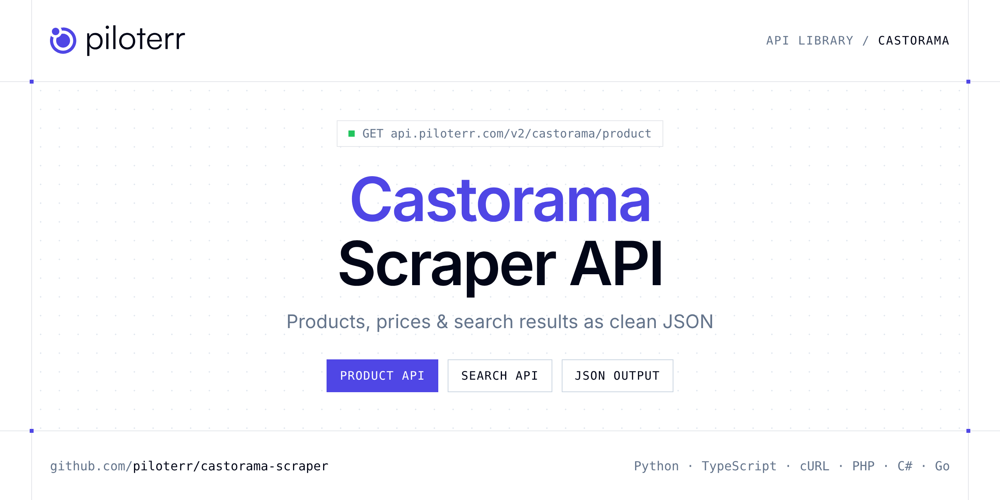

<p align="center">
  <a href="https://www.piloterr.com"></a>
</p>

# Castorama Scraper API

[](https://discord.gg/CFj3ph8aHU) [](https://app.piloterr.com) [](https://app.piloterr.com/openapi) [](LICENSE)

The **Piloterr Castorama Scraper API** lets you extract public data from Castorama as **clean, structured JSON** — no proxies, headless browsers or HTML parsing to maintain. Endpoints available in production:

- **Castorama Product API** — Read one Castorama product from its URL.
- **Castorama Search API** — Search Castorama by keyword or search URL and page the DIY listings.

Use it for price monitoring, assortment tracking, competitor analysis, product research or catalog enrichment.

| Endpoint | Path | Credits | What you get |
|---|---|---|---|
| [Castorama Product API](#castorama-product-api) | `/v2/castorama/product` | 1 | Read one Castorama product from its URL. You get price, brand, and specifications. |
| [Castorama Search API](#castorama-search-api) | `/v2/castorama/search` | 1 | Search Castorama by keyword or search URL and page the DIY listings. Cards include title, price, and product link. |

## Table of contents

- [How it works](#how-it-works)
- [Castorama Product API](#castorama-product-api)
- [Castorama Search API](#castorama-search-api)
- [Code examples in other languages](#code-examples-in-other-languages)
- [Practical use cases](#practical-use-cases)
- [Why Piloterr?](#why-piloterr)
- [FAQ](#faq)
- [Related scrapers](#related-scrapers)
- [Support](#support)

## How it works

1. **Create a free Piloterr account** and copy your API key from the [dashboard](https://app.piloterr.com).
2. **Send a `GET` (or `POST`) request** to `https://api.piloterr.com/v2/...` with the header `x-api-key: YOUR_API_KEY`.
3. **Receive structured JSON** — Piloterr handles rendering, proxies, retries and parsing.

```bash
export PILOTERR_API_KEY="your-api-key"
pip install requests        # Python
# TypeScript: Node.js 18+ (native fetch), run with `npx tsx file.ts`
```

> Every endpoint accepts both `GET` (query string) and `POST` (JSON body with the same fields).

## Castorama Product API

Read one Castorama product from its URL. You get price, brand, and specifications.

`GET | POST https://api.piloterr.com/v2/castorama/product` · **1 credit per request** · [Full reference](https://app.piloterr.com/openapi)

### Request parameters

| Parameter | Type | Required | Description |
|---|---|---|---|
| `query` | string | ✅ | Product URL ending in `_CAFR.prd`. |

### Python example

```python
import json
import os
import requests

response = requests.get(
    "https://api.piloterr.com/v2/castorama/product",
    headers={"x-api-key": os.environ["PILOTERR_API_KEY"]},
    params={
        "query": "https://www.castorama.fr/mastic-bain-et-cuisine-rubson-blanc-280ml/5410091628840_CAFR.prd",
    },
    timeout=60,
)
response.raise_for_status()
data = response.json()

print(json.dumps(data, indent=2, ensure_ascii=False)[:2000])
```

### TypeScript example

```typescript
type CastoramaProduct = {
  ean?: string;
  url?: string;
  name?: string;
  brand?: string;
  price?: number;
  images?: string[];
  rating?: number;
  currency?: string;
  in_stock?: boolean;
  was_price?: unknown;
  description?: string;
  review_count?: number;
  price_display?: string;
  specifications?: {
    name?: string;
    value?: string;
  }[];
  was_price_display?: unknown;
};

const params = new URLSearchParams({
  "query": "https://www.castorama.fr/mastic-bain-et-cuisine-rubson-blanc-280ml/5410091628840_CAFR.prd",
});

const response = await fetch(`https://api.piloterr.com/v2/castorama/product?${params}`, {
  headers: { "x-api-key": process.env.PILOTERR_API_KEY! },
});
if (!response.ok) throw new Error(`Piloterr error ${response.status}: ${await response.text()}`);

const data = (await response.json()) as CastoramaProduct;

console.log(JSON.stringify(data, null, 2).slice(0, 2000));
```

<details>
<summary><b>POST variant</b></summary>

```http
POST https://api.piloterr.com/v2/castorama/product
x-api-key: YOUR_API_KEY
Content-Type: application/json

{"query": "https://www.castorama.fr/mastic-bain-et-cuisine-rubson-blanc-280ml/5410091628840_CAFR.prd"}
```
</details>

### Output example

Example response from the API reference, abridged — real values depend on the page you scrape.

```json
{
  "ean": "5410091628840",
  "url": "https://www.castorama.fr/mastic-bain-et-cuisine-rubson-blanc-280ml/5410091628840_CAFR.prd",
  "name": "Mastic bain et cuisine Rubson blanc 280ml",
  "brand": "Rubson",
  "price": 10.9,
  "images": [
    "https://media.castorama.fr/is/image/Castorama/mastic-bain-et-cuisine-rubson-blanc-280ml~5410091628840_30c_FR_CF",
    "https://media.castorama.fr/is/image/Castorama/mastic-bain-et-cuisine-rubson-blanc-280ml~5410091628840_30t_FR_CF"
  ],
  "rating": 4.5,
  "currency": "EUR",
  "in_stock": true,
  "was_price": null,
  "description": "Le mastic sanitaire Rubson blanc de 280 ml garantit une étanchéité parfaite et durable pour vos baignoires, éviers et douches. Conçu spéc…",
  "review_count": 55,
  "price_display": "10,90 €",
  "specifications": [
    {
      "name": "Type d'article",
      "value": "Mastic cuisine et salle de bains"
    },
    {
      "name": "Marque",
      "value": "Rubson"
    }
  ],
  "was_price_display": null
}
```

### Response fields

| Field | Type | Description |
|---|---|---|
| `ean` | string |  |
| `url` | string |  |
| `name` | string |  |
| `brand` | string |  |
| `price` | number |  |
| `images` | string[] |  |
| `rating` | number |  |
| `currency` | string |  |
| `in_stock` | boolean |  |
| `was_price` | object |  |
| `description` | string |  |
| `review_count` | integer |  |
| `price_display` | string |  |
| `specifications[]` | object[] |  |
| `specifications[].name` | string |  |
| `specifications[].value` | string |  |
| `was_price_display` | object |  |

## Castorama Search API

Search Castorama by keyword or search URL and page the DIY listings. Cards include title, price, and product link.

`GET | POST https://api.piloterr.com/v2/castorama/search` · **1 credit per request** · [Full reference](https://app.piloterr.com/openapi)

### Request parameters

| Parameter | Type | Required | Description |
|---|---|---|---|
| `query` | string | ✅ | Keyword, or a Castorama listing URL (`/search` or a `.cat` category). |
| `page` | number | — | Page from 1. Sent as ?page= on the listing. |

### Python example

```python
import json
import os
import requests

response = requests.get(
    "https://api.piloterr.com/v2/castorama/search",
    headers={"x-api-key": os.environ["PILOTERR_API_KEY"]},
    params={
        "query": "joint-silicone",
    },
    timeout=60,
)
response.raise_for_status()
data = response.json()

print(json.dumps(data, indent=2, ensure_ascii=False)[:2000])
```

### TypeScript example

```typescript
type CastoramaSearch = {
  results?: {
    ean?: string;
    url?: string;
    name?: string;
    image?: string;
    price?: number;
    rating?: number;
    currency?: string;
    position?: number;
    was_price?: unknown;
    unit_price?: number;
    review_count?: number;
    price_display?: string;
    was_price_display?: unknown;
    unit_price_display?: string;
  }[];
  pagination?: {
    next?: string;
    page?: number;
    per_page?: number;
    total_pages?: number;
    total_results?: number;
  };
};

const params = new URLSearchParams({
  "query": "joint-silicone",
});

const response = await fetch(`https://api.piloterr.com/v2/castorama/search?${params}`, {
  headers: { "x-api-key": process.env.PILOTERR_API_KEY! },
});
if (!response.ok) throw new Error(`Piloterr error ${response.status}: ${await response.text()}`);

const data = (await response.json()) as CastoramaSearch;

console.log(JSON.stringify(data, null, 2).slice(0, 2000));
```

<details>
<summary><b>POST variant</b></summary>

```http
POST https://api.piloterr.com/v2/castorama/search
x-api-key: YOUR_API_KEY
Content-Type: application/json

{"query": "joint-silicone"}
```
</details>

### Output example

Example response from the API reference, abridged — real values depend on the page you scrape.

```json
{
  "results": [
    {
      "ean": "5410091628840",
      "url": "https://www.castorama.fr/mastic-bain-et-cuisine-rubson-blanc-280ml/5410091628840_CAFR.prd",
      "name": "Mastic bain et cuisine Rubson blanc 280ml",
      "image": "https://media.castorama.fr/is/image/Castorama/mastic-bain-et-cuisine-rubson-blanc-280ml~5410091628840_30c_FR_CF",
      "price": 10.9,
      "rating": 4.5,
      "currency": "EUR",
      "position": 1,
      "was_price": null,
      "unit_price": 38.93,
      "review_count": 55,
      "price_display": "10,90 €",
      "was_price_display": null,
      "unit_price_display": "38,93 € / L"
    }
  ],
  "pagination": {
    "next": "https://www.castorama.fr/search?term=joint-silicone&page=2",
    "page": 1,
    "per_page": 48,
    "total_pages": 189,
    "total_results": 9050
  }
}
```

### Response fields

| Field | Type | Description |
|---|---|---|
| `results[]` | object[] |  |
| `results[].ean` | string |  |
| `results[].url` | string |  |
| `results[].name` | string |  |
| `results[].image` | string |  |
| `results[].price` | number |  |
| `results[].rating` | number |  |
| `results[].currency` | string |  |
| `results[].position` | integer |  |
| `results[].was_price` | object |  |
| `results[].unit_price` | number |  |
| `results[].review_count` | integer |  |
| `results[].price_display` | string |  |
| `results[].was_price_display` | object |  |
| `results[].unit_price_display` | string |  |
| `pagination` | object |  |
| `pagination.next` | string |  |
| `pagination.page` | integer |  |
| `pagination.per_page` | integer |  |
| `pagination.total_pages` | integer |  |
| `pagination.total_results` | integer |  |

## Code examples in other languages

Ready-to-run examples live in the [`examples/`](examples) folder. Each one reads your key from the `PILOTERR_API_KEY` environment variable.

| Language | Product | Search |
|---|---|---|
| cURL (Bash) | [`product`](examples/curl/product.sh) | [`search`](examples/curl/search.sh) |
| PHP | [`product`](examples/php/product.php) | [`search`](examples/php/search.php) |
| C# | [`product`](examples/csharp/Product.cs) | [`search`](examples/csharp/Search.cs) |
| Go | [`product`](examples/go/product.go) | [`search`](examples/go/search.go) |
| Java | [`product`](examples/java/ProductExample.java) | [`search`](examples/java/SearchExample.java) |
| Ruby | [`product`](examples/ruby/product.rb) | [`search`](examples/ruby/search.rb) |
| Node.js | [`product`](examples/nodejs/product.mjs) | [`search`](examples/nodejs/search.mjs) |

## Practical use cases

- **Price monitoring** — Track prices, promotions and availability over time to react to competitors.
- **Assortment & catalog tracking** — Follow new products, delisted items and category changes.
- **Competitor analysis** — Benchmark ranges, brands and positioning across retailers.
- **Product research** — Spot best-sellers and trends from search results.
- **Catalog enrichment** — Pull titles, images and attributes into your PIM or marketplace listings.

## Why Piloterr?

- **No infrastructure** — no proxies, headless browsers or CAPTCHA solving to run yourself.
- **Structured JSON** — stable, documented fields instead of brittle HTML selectors.
- **Pay per request** — transparent credit cost per endpoint, failed requests are retried for you.
- **One API key, hundreds of sources** — Castorama plus many other e-commerce, search and company data endpoints in the [Piloterr library](https://www.piloterr.com/library).
- **Any language** — plain HTTPS + JSON, with examples for Python, TypeScript, cURL, PHP, C#, Go, Java, Ruby and Node.js.

## FAQ

### Is it legal to scrape Castorama?

Collecting publicly available data is generally allowed in many jurisdictions, but rules depend on your country, the data you collect and how you use it. Avoid personal data unless you have a lawful basis, respect the website's terms where they apply, and get legal advice for your specific use case. This is not legal advice.

### Do I need proxies or a headless browser?

No. Piloterr handles rendering, proxy rotation and retries on its side. You only send an HTTPS request with your `x-api-key` header and receive JSON.

### How much does a request cost?

Credits per call: `/v2/castorama/product` **1**, `/v2/castorama/search` **1**. See the [Piloterr website](https://www.piloterr.com) for plans.

### What data does the Castorama API return?

Each endpoint returns structured JSON: **Castorama Product** — `ean`, `url`, `name`, `brand`, `price`, `images`; **Castorama Search** — `results[]`, `results[].ean`, `results[].url`, `results[].name`, `results[].image`, `results[].price`.

### How do I paginate Castorama results?

Use the `page` parameter and keep requesting while the response indicates more results.

### Which languages are supported?

Any language that can make an HTTP request. This README shows Python and TypeScript; the [`examples/`](examples) folder contains cURL, PHP, C#, Go, Java, Ruby and Node.js.

## Related scrapers

- [About You Scraper API](https://github.com/piloterr/aboutyou-scraper)
- [Action Scraper API](https://github.com/piloterr/action-scraper)
- [Aldi Scraper API](https://github.com/piloterr/aldi-scraper)
- [Alibaba Scraper API](https://github.com/piloterr/alibaba-scraper)
- [AliExpress Scraper API](https://github.com/piloterr/aliexpress-scraper)
- [Allegro Scraper API](https://github.com/piloterr/allegro-scraper)
- [All Piloterr scrapers on GitHub](https://github.com/piloterr)

## Support

- 💬 Join the [Piloterr Discord](https://discord.gg/CFj3ph8aHU) to ask questions and share what you build.
- 📚 Browse the [API reference (OpenAPI)](https://app.piloterr.com/openapi) and the [Piloterr library](https://www.piloterr.com/library).
- 🔑 [Get your API key](https://app.piloterr.com).

---

<p align="center">
  <a href="https://www.piloterr.com">
    <picture>
      <source media="(prefers-color-scheme: dark)" srcset="images/logo-dark.svg">
      
    </picture>
  </a>
  <br>
  <sub>Built by <a href="https://www.piloterr.com">Piloterr</a> — web scraping APIs for e-commerce, search, real estate and more, one API key.</sub>
</p>

<sub>Castorama is a trademark of its respective owner. This repository is not affiliated with or endorsed by Castorama. Examples are released under the MIT license.</sub>
